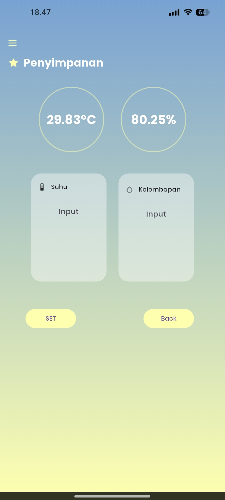
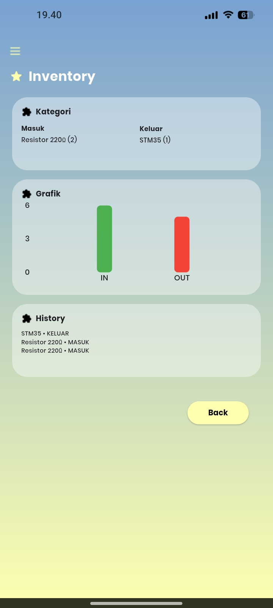
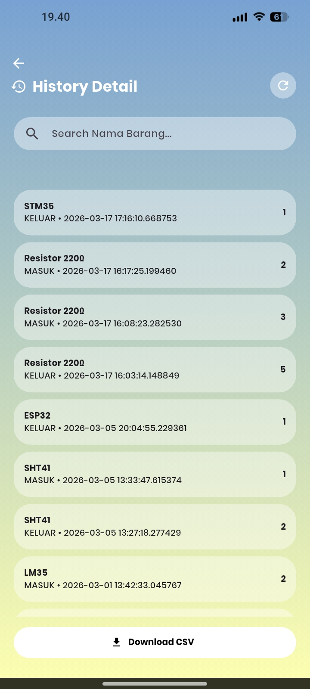
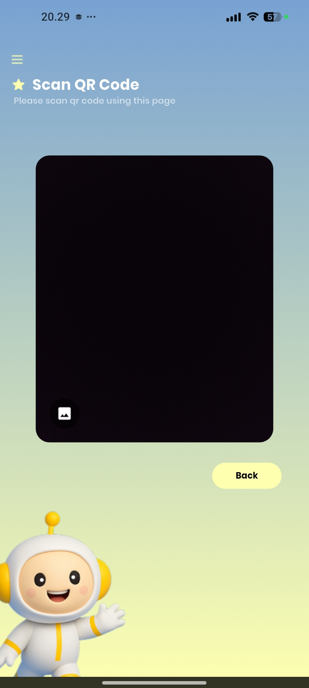
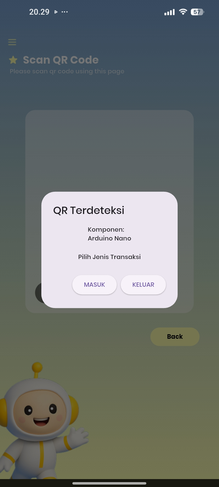
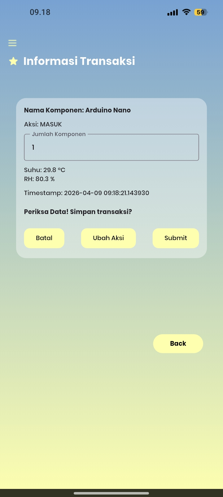
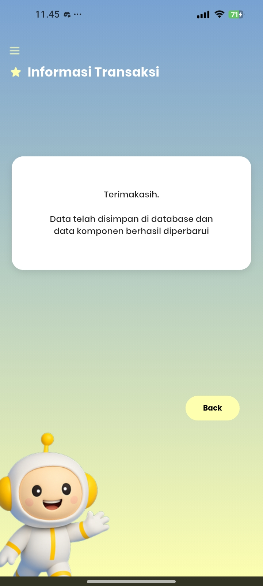

# General Dry Box IoT Monitoring & Inventory System

An Android-based application for real-time environmental monitoring and inventory management using Internet of Things (IoT) technology.

Developed as a Final Project for the Diploma III Computer Control Engineering Program at Politeknik Negeri Madiun (2026).

## Overview

The General Dry Box system is designed to monitor temperature and humidity conditions in storage environments while supporting inventory management.

The system integrates an SHT41 sensor with an ESP32 microcontroller, Firebase Realtime Database, Google Sheets, and an Android application developed using Flutter.

## Technologies Used

| Technology | Purpose |
|---|---|
| Flutter & Dart | Android application development |
| ESP32 | Microcontroller and data transmission |
| SHT41 | Temperature and humidity sensing |
| Firebase Realtime Database | Real-time data storage |
| Google Sheets | Monitoring history recording |
| QR Code Scanner | Inventory transaction management |

## Key Features

- **Real-Time Monitoring:** Displays temperature and humidity readings.
- **Setpoint Management:** Allows users to configure temperature and humidity targets.
- **Inventory Management:** Supports recording and managing stored items.
- **QR Code Scanner:** Facilitates incoming and outgoing inventory transactions.
- **Monitoring History:** Documents historical monitoring data through Google Sheets.

## Application Screenshots

### Dashboard
.jpeg)

### Monitoring History

### Inventory

### History

### QR Code Scanner

### Transaction

## System Architecture

SHT41 Sensor → ESP32 → Firebase Realtime Database → Flutter Android Application

Google Sheets is integrated for historical monitoring data recording.

## Repository Structure

- `assets/` — Application screenshots and visual assets.
- `documentation/` — Project documentation and system diagrams.
- `source-code/flutter/` — Flutter application source code.

## Project Information

- Institution: Politeknik Negeri Madiun
- Program: Diploma III Computer Control Engineering
- Project Type: Final Project
- Year: 2026

---

**Project Status:** Academic Final Project Completed.

Developed by Anggie Fatika Aulia Pratama.
